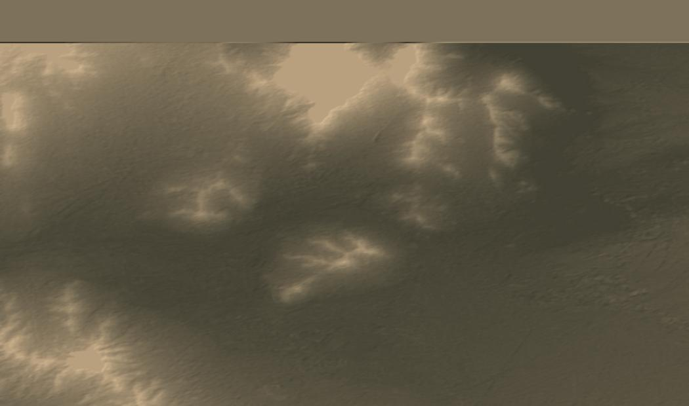
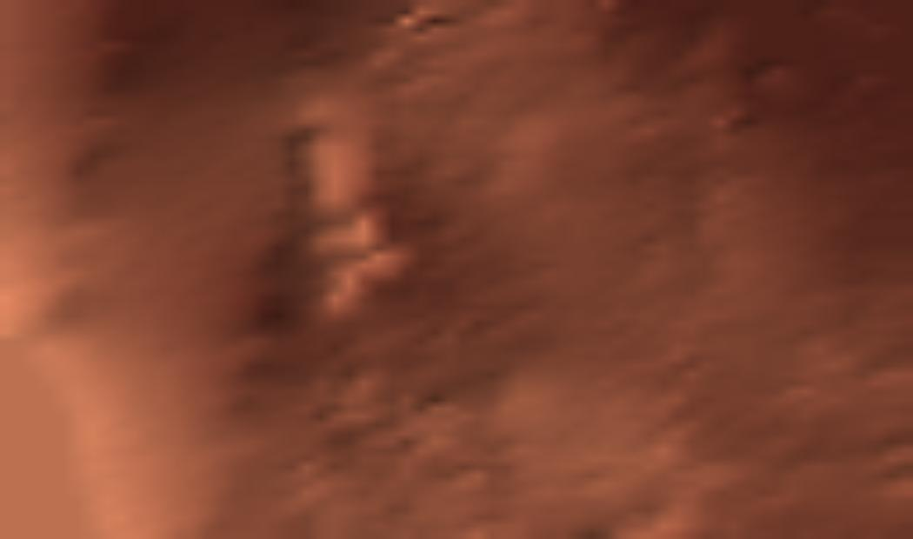
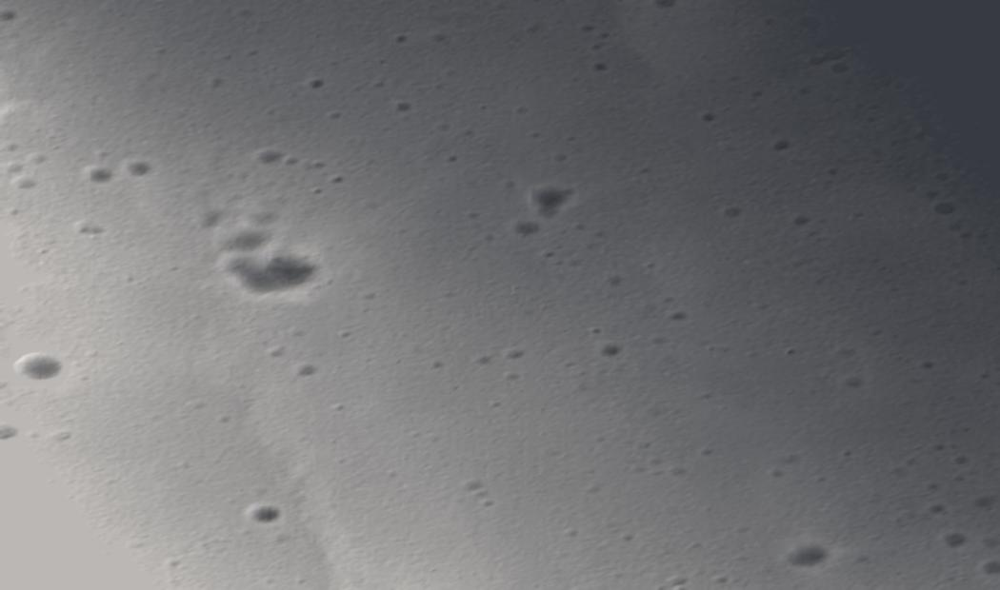

# 🌎 TerraMatch Chile
**Explore Earth. Understand Other Worlds.**

**Team Joseadores · Universidad de La Frontera · Temuco, Chile · NASA Space Apps Challenge 2026**

[🌐 Explore the live prototype](https://terramatch-chile-v07.streamlit.app/) · [🔬 Scientific methodology](docs/methodology.md) · [📊 Pilot results](results/README.md) · [✅ Claims and supporting evidence](docs/validation/AFIRMACIONES_Y_EVIDENCIA.md) · [🇨🇱 Resumen en español](#resumen-en-español)

> **Research prototype — pilot study only.** TerraMatch Chile evaluates *partial topographic similarities*; it does not certify terrestrial planetary analogues, identify safe landing sites, or provide a national ranking. This is a Space Apps team project, not a NASA-endorsed product.

## What is TerraMatch Chile?

**TerraMatch Chile is a working, bilingual geospatial web application** that helps visitors investigate how selected terrains in Chile compare with reference regions on Mars and the Moon. It brings together elevation models, environmental screening layers, reproducible terrain measurements, and explanations of data quality and limitations.

Instead of identifying an analogue from visual resemblance alone, the project asks:

**Which Chilean environments share measurable characteristics with particular Martian and lunar terrains, where do they differ, and which questions could justify further investigation?**

| Chile: ASTER GDEM v3 | Mars: MOLA MEGDR | Moon: SLDEM2015 |
| :---: | :---: | :---: |
|  |  |  |
| Chilean pilot terrain | Western Elysium Planitia | Mare Tranquillitatis |

*These are elevation-derived terrain renderings, **not optical photographs**. See [visualization credits](assets/visuals/ATTRIBUTION.md).*

## Try the application

**Live app:** https://terramatch-chile-v07.streamlit.app/

The Streamlit interface offers **English and Spanish** and seven guided sections:

1. **Home:** the research question, study context, and paths into the explorer.
2. **About the Project:** what a partial terrestrial analogue means and why Chile is relevant.
3. **How It Works:** data sources, harmonization, environmental filters, and terrain scoring.
4. **Explore Chile:** interactive pilot-area maps, Mars/Moon selection, valid cell scores, and coverage information.
5. **Site Profiles:** five site-level explanations with elevation-derived visualizations and measured variables.
6. **Results & Validation:** the tests the model passed **and** the benchmarks it did not meet.
7. **Data & Limitations:** sources, status explanations, uncertainty, and reproducibility caveats.

The app reads the real pilot result files, rather than calculating new scores in the browser. **A cell excluded by a filter or lacking sufficient data is never assigned a low similarity score.** The map's blank or unscored areas must not be interpreted as zero similarity.

## Data and scientific approach

| Study component | Data and role |
| --- | --- |
| **Chile — terrain** | **ASTER GDEM v3**: terrestrial elevation and its original NUM quality layers |
| **Mars — reference terrain** | **MOLA MEGDR**, western **Elysium Planitia** |
| **Moon — reference terrain** | **SLDEM2015 (LOLA + Kaguya)**, **Mare Tranquillitatis** |
| **Mars — screening filter** | **GPM IMERG Final V07**: 2001–2024 mean annual precipitation, **≤250 mm/year** |
| **Moon — screening filter** | Preliminary volcanic-unit classification from **SERNAGEOMIN 1:1,000,000** geology; third-party copy requiring further verification |

Terrain is compared at an approximately **463 m effective resolution**, using **5 km analysis windows**. Only three measurements contribute to the MVP's numerical similarity score:

- **Slope P90 (°):** 90th percentile of terrain slope.
- **Local relief P95–P5 (m):** difference between high and low elevation percentiles.
- **Roughness (°):** standard deviation of slope.

The profile-specific aridity or geology filter determines **eligibility**, not an added similarity bonus. For eligible cells, the analysis computes an explainable **topographic similarity score S (0–100)**, reports data coverage, and evaluates ranking sensitivity with **500 Monte Carlo iterations**. A value of **100 is not a 100% planetary-equivalence claim**.

Full technical definitions and algorithms are available in [docs/methodology.md](docs/methodology.md) and the [v0.7 engine report](docs/engine_v07/RESULTADOS_v0.7.md).

## What the pilot actually found

**Geographic scope:** four ASTER GDEM v3 tiles (**S25W070, S25W069, S26W069, S39W072**). The reference grid contains 31,660 Chilean cells, but only **1,262 cells** have the three processed ASTER terrain metrics. Within this pilot, **895 Mars cells** and **256 Moon cells** received valid scores. These are **not nationwide rankings**.

| Test / pilot site | Observed result | Interpretation |
| --- | --- | --- |
| **Yungay → Mars** | **47.4th percentile** | Did **not** meet the expected ≥75th-percentile terrain benchmark |
| **Salar de Pajonales → Mars** | **63.1st percentile** | Did **not** meet the expected ≥75th-percentile terrain benchmark |
| **Llullaillaco → Mars** | **8.3rd percentile** | Met the predefined negative-control criterion (≤25th percentile) |
| **Steep-terrain control → Mars** | **2.5th percentile** | Met its negative-control criterion |
| **Llaima lava-flow sector → Moon** | **S = 39.0/100** | Scored above the Llaima cone, a **relative** terrain comparison |
| **Llaima cone → Moon** | **S = 17.2/100** | Internal topographic contrast |

**Key finding:** arid environments are not necessarily topographic matches to Elysium Planitia at this scale. Yungay and Pajonales are relevant to environmental questions, but their terrain benchmarks did not pass. The mapped Llaima lava-flow sector scores higher than its cone for the lunar profile; **neither is demonstrated to be lunar-equivalent terrain**.

The **five evaluated sites have low reported confidence**. Individual pilot cells can have different confidence classifications; they must not be confused with the site-level ratings. The highest-scoring Martian pilot cell near **24.5° S, 68.9° W** has **not** yet been identified or geologically validated as a specific landform.

**Read the actual outputs:** [Mars and Moon result tables](results/README.md) · [Site summaries](results/sites_summary.csv) · [Validation JSON](results/validation.json) · [Authorized claims and evidence](docs/validation/AFIRMACIONES_Y_EVIDENCIA.md).

## Known limitations

- **Pilot coverage, not national coverage.** Percentiles, normalization, and ranks depend on the four processed ASTER tiles and may change when the study expands.
- **Mars reference uncertainty.** Only **5 of 25** MOLA study windows satisfied the direct-measurement coverage rule; roughly **69%** of source pixels were not directly measured.
- **Terrestrial data quality.** ASTER NUM checks have been reported by the team, but the v0.7 scoring pipeline does **not explicitly use NUM-derived provenance masks**; supporting documentation should remain linked to the original sources.
- **Precipitation screening.** IMERG has known limitations in hyper-arid conditions. The team's complementary CR2MET–IMERG analysis produced similar benchmark percentiles, but does not eliminate uncertainty.
- **Geological interpretation.** The volcanic filter relies on a regional-scale, third-party copy of SERNAGEOMIN mapping; the Pajonales and Llaima flow boundaries are **provisional geological proxies**.
- **Meaning of the score.** Topographic similarity does **not** establish identical materials, atmospheric or thermal conditions, habitability, landing safety, or fitness for mission deployment.

These limits are part of the published result, not hidden exceptions. See [scientific review](docs/reviews/motor_v07_integracion.md) and [data inventory](docs/data_inventory.csv).

## Run the web app locally

Python and the packages in `requirements.txt` are needed for local execution. From the repository root:

~~~bash
python -m pip install -r requirements.txt
python -m streamlit run app.py
~~~

On Windows, `py -m pip` and `py -m streamlit` may be used instead.

The **web app runs from the committed CSV/JSON outputs**, so visitors do not need the large original DEM archives just to explore the pilot results. Re-running the scientific processing requires additional GIS dependencies and original inputs, some of which are archived **outside this repository**.

## Repository guide

| Path | Purpose |
| --- | --- |
| `app.py`, `ui_data.py` | Bilingual Streamlit application and interactive cartography/data loading |
| `assets/visuals/` | Terrain renderings, Chile outline for display, and attribution |
| `src/`, `config/` | Terrain processing, profile construction, scoring, Monte Carlo, and validation |
| `tests/` | Synthetic and safeguard checks (not substitutes for independent field validation) |
| `data/targets.json` | Planetary target metrics and provenance |
| `data/processed/master.csv` | Chilean pilot variables per grid cell |
| `data/chile/sites/` | Reference study-site geometries, including provisional geological proxies |
| `results/` | Real pilot scores, profiles, Monte Carlo tables, and checks |
| `docs/methodology.md` | Detailed method and assumptions |
| `docs/validation/AFIRMACIONES_Y_EVIDENCIA.md` | Scientific claims and their evidence |
| `docs/data_inventory.csv` | Input datasets, availability, and data-quality caveats |
| `scripts/reproducir_recortes_TerraMatch_BJOR.R` | Script documenting the planetary raster crop workflow |

### Reproducibility and AI assistance

The team processed real NASA/planetary and Chilean geospatial inputs and documented the pipeline. Original large ASTER archives and some geospatial source products are not committed to GitHub; therefore, **a full raw-data reproduction requires obtaining those inputs**. The site and score CSV/JSON outputs are included so reviewers can inspect and run the web demo.

AI tools supported portions of coding, debugging, and documentation, with human review and execution by the team. **AI did not invent or adjust the scientific scores to satisfy validation checks.** See [the team's AI log](docs/engine_v07/AI_LOG.md); disclose all relevant AI tools and sources in the official Space Apps submission.

## Resumen en español

**TerraMatch Chile** es un prototipo geoespacial bilingüe desarrollado por el **equipo Joseadores, de la Universidad de La Frontera (Temuco)**, para explorar semejanzas **topográficas parciales** entre ciertos paisajes chilenos y regiones de **Marte (Elysium Planitia)** y **la Luna (Mare Tranquillitatis)**.

La aplicación funciona con resultados de **cuatro teselas ASTER**, correspondientes a **1.262 celdas chilenas procesadas**, de las cuales **895** obtuvieron puntaje para Marte y **256** para la Luna. **No es un ranking nacional**, ni certifica análogos planetarios. Yungay y Pajonales no superaron los benchmarks topográficos previstos; el sector preliminar de coladas del Llaima se parece más al perfil lunar que su cono, pero este resultado es **relativo** y requiere validación geológica.

**[Abrir la plataforma en español o inglés](https://terramatch-chile-v07.streamlit.app/)** · [Ver resultados](results/README.md) · [Leer metodología](docs/methodology.md)

---

*TerraMatch Chile · Team Joseadores · NASA Space Apps Challenge 2026. Open-science research prototype; not affiliated with or endorsed by NASA.*
